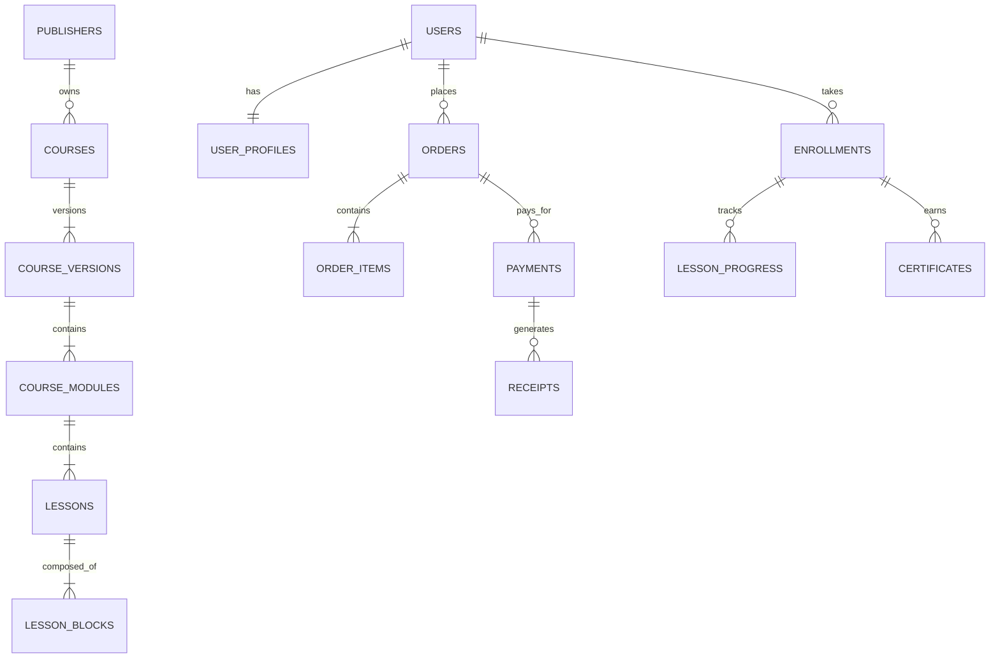

# CourseCity 1.0 — Domain Model & Database Architecture

## 1. Identifier Strategy: Internal UUIDv7 vs. Business References

CourseCity strictly decouples internal surrogate database primary keys from public, human-facing business identifiers:

### 1.1 Internal Primary Keys (UUIDv7)

All database tables utilize **UUIDv7** as their primary key (`id UUID PRIMARY KEY DEFAULT gen_random_uuid()`).

- **Time-ordered**: Monotonically increasing prefix allows efficient B-tree index locality and avoids fragmentation compared to UUIDv4.
- **Distributed**: Non-enumerable, secure against IDOR and crawler discovery.

### 1.2 Public Business Identifiers

Human-facing identifiers are generated using structured business prefixes, high-entropy cryptographic randomness, and Crockford Base32 / alphanumeric encodings:

- **Orders**: `CC-ORD-YYYYMMDD-XXXXXX` (e.g., `CC-ORD-20261003-8K9F2M`)
- **Payments**: `CC-PAY-YYYYMMDD-XXXXXX` (e.g., `CC-PAY-20261003-7J2L9Q`)
- **Receipts**: `CC-RCP-YYYYMMDD-XXXXXX` (e.g., `CC-RCP-20261003-4M8P1K`)
- **Certificates**: `CC-CERT-YYYYMMDD-XXXXXX` (e.g., `CC-CERT-20261003-9V4W7Z`)
- **API Keys**: `cc_live_prefix_...` / `cc_test_prefix_...`

These identifiers are stored with explicit `UNIQUE` constraints in their respective tables and are used for customer communications, public lookups, and audit trails.

---

## 2. Comprehensive Entity Schema Breakdown



### 2.1 Identity Domain

- **`users`**: Core user credentials and status.
  - `id` (UUIDv7, PK), `email` (VARCHAR(255), UNIQUE), `password_hash` (TEXT, Argon2id), `status` (VARCHAR(32), Enum: `PENDING_VERIFICATION`, `ACTIVE`, `SUSPENDED`, `DEACTIVATED`), `email_verified_at` (TIMESTAMPTZ), `mfa_enabled` (BOOLEAN DEFAULT FALSE), `mfa_secret_encrypted` (TEXT), `created_at`, `updated_at`.
- **`user_profiles`**: Personal presentation data.
  - `id` (UUIDv7, PK), `user_id` (UUID, FK -> users.id, UNIQUE), `first_name` (VARCHAR(100)), `last_name` (VARCHAR(100)), `display_name` (VARCHAR(100)), `avatar_url` (TEXT), `bio` (TEXT), `phone_number` (VARCHAR(32)), `whatsapp_enabled` (BOOLEAN DEFAULT FALSE), `created_at`, `updated_at`.
- **`sessions`**: Server-side session tracking for active browser/mobile logins.
  - `id` (UUIDv7, PK), `user_id` (UUID, FK -> users.id), `session_token_hash` (VARCHAR(64), UNIQUE), `ip_address` (INET), `user_agent` (TEXT), `status` (VARCHAR(32), Enum: `ACTIVE`, `REVOKED`, `EXPIRED`, `REPLACED`), `last_activity_at` (TIMESTAMPTZ), `expires_at` (TIMESTAMPTZ), `created_at`.
- **`refresh_tokens`**: Rotating refresh tokens for API authentication.
  - `id` (UUIDv7, PK), `session_id` (UUID, FK -> sessions.id), `user_id` (UUID, FK -> users.id), `token_hash` (VARCHAR(64), UNIQUE), `sequence_number` (INT), `revoked_at` (TIMESTAMPTZ), `expires_at` (TIMESTAMPTZ), `created_at`.
- **`email_verification_tokens`**: Short-lived hashed email validation codes.
  - `id` (UUIDv7, PK), `user_id` (UUID, FK -> users.id), `token_hash` (VARCHAR(64), UNIQUE), `expires_at` (TIMESTAMPTZ), `used_at` (TIMESTAMPTZ), `created_at`.
- **`password_reset_tokens`**: Single-use password reset tokens.
  - `id` (UUIDv7, PK), `user_id` (UUID, FK -> users.id), `token_hash` (VARCHAR(64), UNIQUE), `expires_at` (TIMESTAMPTZ), `used_at` (TIMESTAMPTZ), `created_at`.

### 2.2 Roles & Permissions Domain

- **`roles`**: Global and scoped roles (`LEARNER`, `INSTRUCTOR`, `ORGANIZATION_ADMIN`, `ADMIN`, `FINANCE_ADMIN`, `SUPER_ADMIN`).
- **`permissions`**: Fine-grained capability strings (`courses.read`, `courses.create`, `courses.publish`, `users.manage`, `payments.read`, `refunds.create`, `receipts.verify`, `receipts.revoke`).
- **`role_permissions`**: Many-to-many join between roles and permissions.
- **`user_roles`**: User role assignments with optional publisher/organization resource scope.

### 2.3 Publisher & Marketplace Domain

- **`publishers`**: Publishing entities (`type`: `PLATFORM`, `INSTRUCTOR`, `ORGANIZATION`).
  - `id` (UUIDv7, PK), `name` (VARCHAR(200)), `slug` (VARCHAR(200), UNIQUE), `type` (VARCHAR(32)), `verified` (BOOLEAN DEFAULT FALSE), `created_at`, `updated_at`.
- **`instructor_profiles`**: Extended educator metadata, qualifications, and social links.
- **`organizations`**: Legal entities with corporate branding and enterprise settings.
- **`organization_members`**: Organization staffing linking users to roles (`OWNER`, `ADMIN`, `INSTRUCTOR`, `CONTENT_EDITOR`, `FINANCE_MEMBER`, `ANALYTICS_MEMBER`).
- **`publisher_members`**: Membership links scoping users to publisher administrative rights.

### 2.4 Courses & Curriculum Domain

- **`courses`**: Top-level course container.
  - `id` (UUIDv7, PK), `publisher_id` (UUID, FK -> publishers.id), `slug` (VARCHAR(255), UNIQUE), `status` (Enum: `DRAFT`, `IN_REVIEW`, `APPROVED`, `PUBLISHED`, `UNPUBLISHED`, `ARCHIVED`, `SUSPENDED`), `active_version_id` (UUID), `created_at`, `updated_at`.
- **`course_versions`**: Immutable or drafting versions of a course curriculum.
  - `id` (UUIDv7, PK), `course_id` (UUID, FK -> courses.id), `version_number` (INT), `title` (VARCHAR(255)), `subtitle` (TEXT), `description` (TEXT), `cover_image_url` (TEXT), `level` (Enum: `BEGINNER`, `INTERMEDIATE`, `ADVANCED`, `ALL_LEVELS`), `estimated_duration_minutes` (INT), `status` (Enum: `DRAFT`, `READY_FOR_REVIEW`, `PUBLISHED`, `SUPERSEDED`, `ARCHIVED`), `created_at`, `published_at`.
- **`course_categories`** & **`course_category_links`**: Hierarchical category taxonomy.
- **`course_instructors`**: Instructors attributed to a specific course version.
- **`course_modules`**: Curriculum chapters/modules with sequential display order.
- **`lessons`**: Ebook/tutorial units belonging to a module.
  - `id` (UUIDv7, PK), `module_id` (UUID, FK -> course_modules.id), `title` (VARCHAR(255)), `slug` (VARCHAR(255)), `sort_order` (INT), `estimated_read_time_minutes` (INT), `is_previewable` (BOOLEAN DEFAULT FALSE).
- **`lesson_blocks`**: Structured atomic content blocks.
  - `id` (UUIDv7, PK), `lesson_id` (UUID, FK -> lessons.id), `block_type` (Enum: `HEADING`, `PARAGRAPH`, `IMAGE`, `CODE`, `TABLE`, `CALLOUT`, `QUOTE`, `DIAGRAM`, `FORMULA`, `RESOURCE`, `EXERCISE`), `sort_order` (INT), `content_payload` (JSONB), `created_at`, `updated_at`.
- **`course_assets`**: Downloadable attachments, templates, and supplemental materials.

### 2.5 Commerce & Payment Domain

- **`products`**: Commercial offerings linked to course entitlements.
- **`prices`**: Integer minor currency amounts (`amount_minor`: e.g. 15000 pesewas = GHS 150.00; `currency`: 'GHS', 'USD').
- **`course_offerings`**: Active commercial associations between courses and prices.
- **`orders`**: Customer purchase orders.
  - `id` (UUIDv7, PK), `order_reference` (VARCHAR(64), UNIQUE, 'CC-ORD-...'), `user_id` (UUID, FK -> users.id), `status` (Enum: `CREATED`, `PENDING_PAYMENT`, `PAID`, `CANCELLED`, `REFUND_PENDING`, `REFUNDED`, `PAYMENT_FAILED`), `total_amount_minor` (BIGINT), `currency` (VARCHAR(3)), `created_at`, `updated_at`.
- **`order_items`**: Line items within an order referencing specific products.
- **`payments`**: Payment transaction attempts.
  - `id` (UUIDv7, PK), `payment_reference` (VARCHAR(64), UNIQUE, 'CC-PAY-...'), `order_id` (UUID, FK -> orders.id), `provider` (VARCHAR(32), e.g., 'PAYSTACK'), `provider_reference` (VARCHAR(128)), `provider_transaction_id` (VARCHAR(128)), `amount_minor` (BIGINT), `currency` (VARCHAR(3)), `status` (Enum: `INITIATED`, `PENDING`, `VERIFIED`, `FAILED`, `CANCEL_PENDING`, `REFUND_PENDING`, `REFUNDED`, `RECONCILIATION_REQUIRED`), `created_at`, `updated_at`.
- **`payment_events`**: Audit log of all raw inbound provider webhook payloads and status changes.
- **`payment_reconciliations`**: Audit table for automated and manual financial reconciliation matches.
- **`payment_reference_links`**: Cross-index linking provider transaction IDs to internal payments.
- **`refunds`** & **`refund_events`**: Authorized refund records with operator identity and audit reasons.
- **`entitlements`**: Authorization grants giving a user learning access.
  - `id` (UUIDv7, PK), `user_id` (UUID, FK -> users.id), `course_id` (UUID, FK -> courses.id), `source_type` (Enum: `PURCHASE`, `FREE_ENROLLMENT`, `ADMIN_GRANT`), `status` (Enum: `PENDING`, `ACTIVE`, `SUSPENDED`, `REVOKED`, `EXPIRED`), `created_at`, `expires_at`.

### 2.6 Learning & Progress Domain

- **`enrollments`**: Active academic relationship between a learner and a course version.
  - `id` (UUIDv7, PK), `user_id` (UUID, FK -> users.id), `course_id` (UUID, FK -> courses.id), `course_version_id` (UUID, FK -> course_versions.id), `status` (Enum: `PENDING`, `ACTIVE`, `COMPLETED`, `SUSPENDED`, `CANCELLED`), `completed_at` (TIMESTAMPTZ), `created_at`.
- **`lesson_progress`**: Per-lesson learner completion state.
  - `id` (UUIDv7, PK), `enrollment_id` (UUID, FK -> enrollments.id), `lesson_id` (UUID, FK -> lessons.id), `is_completed` (BOOLEAN DEFAULT FALSE), `first_read_at` (TIMESTAMPTZ), `completed_at` (TIMESTAMPTZ), `progress_version` (BIGINT DEFAULT 1).
- **`course_progress`**: Aggregated course percentage and monotonic tracking.
- **`bookmarks`**: User-saved lesson anchors and reading positions.
- **`learner_notes`**: Private markdown annotations created by the learner on specific lessons.
- **`learning_activity`**: High-resolution audit timeline of study sessions and actions.

### 2.7 Assessments & Grading Domain

- **`assessments`**: Quizzes, assignments, and examinations linked to course modules.
- **`assessment_questions`**: Questions supporting `SINGLE_CHOICE`, `MULTIPLE_CHOICE`, `TRUE_FALSE`, `SHORT_ANSWER`.
- **`question_options`**: Valid and distracter answer options.
- **`assessment_attempts`**: Student attempts on formative quizzes.
- **`assignments`**: Summative open-ended prompts requiring manual file/text submission.
- **`assignment_submissions`**: Student assignment payloads (`DRAFT`, `SUBMITTED`, `GRADED`).
- **`assignment_grades`**: Instructor feedback and numerical score.
- **`examinations`**: Timed formal examinations with server-side countdown rules.
- **`examination_attempts`**: Exam session tracking start time, expiration, submitted answers, and auto-timeout.
- **`gradebook_entries`**: Consolidated grades for a learner across all assessments in a course.
- **`grading_rules`**: Course completion requirements (e.g. 100% lessons + minimum 80% exam score).

### 2.8 Credentials (Certificates) Domain

- **`certificates`**: Publicly verifiable graduation credentials.
  - `id` (UUIDv7, PK), `certificate_reference` (VARCHAR(64), UNIQUE, 'CC-CERT-...'), `user_id` (UUID, FK -> users.id), `course_id` (UUID, FK -> courses.id), `course_version_id` (UUID, FK -> course_versions.id), `enrollment_id` (UUID, FK -> enrollments.id), `recipient_name` (VARCHAR(200)), `course_title` (VARCHAR(255)), `final_grade` (NUMERIC(5,2)), `status` (Enum: `PENDING`, `ISSUED`, `VERIFIED`, `REVOKED`, `SUPERSEDED`), `ed25519_signature` (TEXT), `payload_hash` (VARCHAR(64)), `issued_at` (TIMESTAMPTZ), `revoked_at` (TIMESTAMPTZ), `revocation_reason` (TEXT).
- **`certificate_events`**: Audit trail of certificate generation, verification queries, and revocations.

### 2.9 Receipts & Verification Domain

- **`receipts`**: Cryptographically verifiable commercial transaction records.
  - `id` (UUIDv7, PK), `receipt_reference` (VARCHAR(64), UNIQUE, 'CC-RCP-...'), `order_id` (UUID, FK -> orders.id), `payment_id` (UUID, FK -> payments.id), `user_id` (UUID, FK -> users.id), `amount_minor` (BIGINT), `currency` (VARCHAR(3)), `status` (Enum: `GENERATING`, `ISSUED`, `DELIVERED`, `VERIFIED`, `REVOKED`, `SUPERSEDED`), `ed25519_signature` (TEXT), `payload_hash_sha256` (VARCHAR(64)), `canonical_payload` (JSONB), `signing_key_id` (VARCHAR(64)), `issued_at` (TIMESTAMPTZ), `revoked_at` (TIMESTAMPTZ), `revocation_reason` (TEXT).
- **`receipt_events`**: History of receipt generation, email delivery attempts, and PDF rendering.
- **`receipt_verifications`**: Log of public verification lookups on `/r/:receiptId`.
- **`receipt_signing_keys`**: Registry of public keys and active key versions for Ed25519 verification.

### 2.10 API Platform & Developer Domain

- **`api_clients`**: Registered consumer applications.
- **`api_keys`**: Scoped developer credentials (`key_prefix`, `secret_hash`, `scopes`, `status`).
- **`api_scopes`** & **`api_key_scopes`**: Permissions granted to third-party clients.
- **`api_usage_events`**: Rate-limiting and telemetry records.
- **`webhook_endpoints`**: Developer URLs registered to receive signed events.
- **`webhook_deliveries`**: Outbound event delivery logs with HMAC signatures and retry states.

### 2.11 Notifications Domain

- **`notifications`**: In-app notifications delivered to user notification trays.
- **`notification_preferences`**: User channel subscriptions (Email, In-App, WhatsApp).
- **`email_events`**: Logs of transactional emails queued, sent, bounced, or opened.
- **`whatsapp_events`**: Logs of operational WhatsApp messages dispatched via provider abstraction.

### 2.12 Platform Operations & Concurrency Domain

- **`idempotency_keys`**: State store for idempotent operations preventing duplicate payments or writes.
  - `id` (UUIDv7, PK), `scope` (VARCHAR(64)), `key` (VARCHAR(255)), `actor_id` (UUID), `request_hash` (VARCHAR(64)), `status` (Enum: `PENDING`, `COMPLETED`, `FAILED`), `response_status` (INT), `response_body` (JSONB), `resource_type` (VARCHAR(64)), `resource_id` (UUID), `expires_at` (TIMESTAMPTZ), `created_at`. UNIQUE(`scope`, `key`, `actor_id`).
- **`resource_versions`**: Optimistic concurrency locking records.
- **`system_settings`**: Global configuration key-values.
- **`feature_flags`**: Granular feature rollouts per environment/role.
- **`outbox_events`**: Outbox queue for reliable asynchronous domain event delivery.
- **`dead_letter_events`**: Poison-pill events retained for manual administrator remediation.
- **`maintenance_windows`** & **`incidents`**: System status and scheduled downtime tracking.

---

## 3. The 18 Frozen Lifecycle State Machines

Every business workflow follows an explicit, server-validated state machine. Transitions outside these specifications are strictly rejected.

```text
1. User Account:
   PENDING_VERIFICATION -> ACTIVE -> SUSPENDED -> DEACTIVATED
   (ACTIVE -> DEACTIVATED, SUSPENDED -> ACTIVE)

2. Session:
   ACTIVE -> REVOKED | EXPIRED | REPLACED

3. Course:
   DRAFT -> IN_REVIEW -> APPROVED -> PUBLISHED -> UNPUBLISHED -> ARCHIVED
   (PUBLISHED -> SUSPENDED, SUSPENDED -> PUBLISHED)

4. Course Version:
   DRAFT -> READY_FOR_REVIEW -> PUBLISHED -> SUPERSEDED -> ARCHIVED

5. Order:
   CREATED -> PENDING_PAYMENT -> PAID -> REFUND_PENDING -> REFUNDED
   (CREATED -> CANCELLED, PENDING_PAYMENT -> PAYMENT_FAILED)

6. Payment:
   INITIATED -> PENDING -> VERIFIED -> REFUND_PENDING -> REFUNDED
   (INITIATED -> FAILED, PENDING -> RECONCILIATION_REQUIRED -> VERIFIED)

7. Payment Reconciliation:
   UNRECONCILED -> MATCHED -> RECONCILED
   (UNRECONCILED -> MISMATCH -> REQUIRES_REVIEW -> RESOLVED)

8. Entitlement:
   PENDING -> ACTIVE -> SUSPENDED -> REVOKED | EXPIRED
   (SUSPENDED -> ACTIVE)

9. Enrollment:
   PENDING -> ACTIVE -> COMPLETED
   (ACTIVE -> SUSPENDED -> ACTIVE, ACTIVE -> CANCELLED)

10. Assessment Attempt:
    NOT_STARTED -> IN_PROGRESS -> SUBMITTED -> GRADING -> GRADED
    (IN_PROGRESS -> EXPIRED, SUBMITTED -> VOIDED)

11. Assignment Submission:
    DRAFT -> SUBMITTED -> UNDER_REVIEW -> GRADED
    (SUBMITTED -> RETURNED -> SUBMITTED, SUBMITTED -> LATE)

12. Examination Attempt:
    SCHEDULED -> IN_PROGRESS -> SUBMITTED -> GRADED
    (IN_PROGRESS -> TIMED_OUT, SUBMITTED -> UNDER_REVIEW -> GRADED, IN_PROGRESS -> VOIDED)

13. Receipt:
    GENERATING -> ISSUED -> DELIVERED -> VERIFIED
    (ISSUED -> REVOKED, ISSUED -> SUPERSEDED)

14. Certificate:
    PENDING -> ISSUED -> VERIFIED
    (ISSUED -> REVOKED, ISSUED -> SUPERSEDED)

15. API Key:
    ACTIVE -> EXPIRING -> EXPIRED | REVOKED

16. Webhook Delivery:
    PENDING -> PROCESSING -> DELIVERED
    (PROCESSING -> RETRYING -> DELIVERED | FAILED -> DEAD_LETTER, PENDING -> DISABLED)

17. Background Job:
    QUEUED -> RUNNING -> SUCCEEDED
    (RUNNING -> RETRYING -> SUCCEEDED | FAILED -> DEAD_LETTER, QUEUED -> CANCELLED)

18. Incident:
    OPEN -> INVESTIGATING -> MITIGATING -> MONITORING -> RESOLVED -> CLOSED
```

---

## 4. Concurrency, Race Condition & Deadlock Rules

### 4.1 Strict Lock Ordering

When an operation requires transactional mutation across multiple commercial entities, PostgreSQL row locks (`SELECT ... FOR UPDATE`) must be acquired in this exact deterministic order:

1. **`orders`**
2. **`payments`**
3. **`entitlements`**
4. **`enrollments`**

Acquiring locks in any other sequence is forbidden to prevent relational deadlocks.

### 4.2 Network Isolation from Transactions

Database transactions must never remain open across external network boundaries:

```typescript
// PROHIBITED ANTI-PATTERN:
await db.transaction().execute(async (trx) => {
  await trx.updateTable('orders').set({ status: 'PAID' }).execute();
  await paystack.verifyTransaction(ref); // FATAL: Holds DB connection across internet
});

// AUTHORITATIVE PATTERN:
const verification = await paystack.verifyTransaction(ref); // Network first
await db.transaction().execute(async (trx) => {             // Short DB transaction (<10ms)
  await trx.updateTable('orders').set({ status: 'PAID' }).execute();
  await trx.insertInto('outbox_events').values({ ... }).execute();
});
```

### 4.3 Monotonic Progress Invariant

Progress updates use conditional SQL updates to prevent stale mobile/browser tabs from reverting learner progress:

```sql
UPDATE lesson_progress
SET is_completed = true, completed_at = NOW(), progress_version = progress_version + 1
WHERE enrollment_id = $1 AND lesson_id = $2 AND is_completed = false;
```

A progress payload reporting an uncompleted state or earlier version is rejected server-side.
