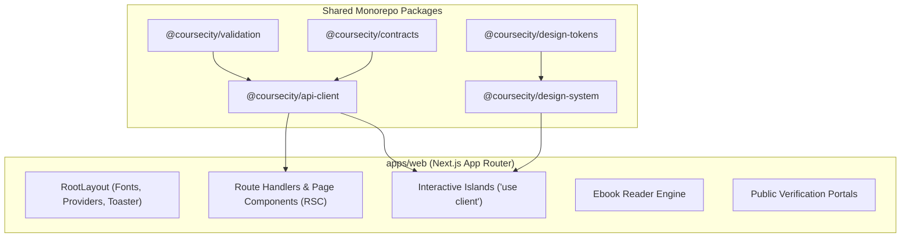

# CourseCity 1.0 — Frontend Architecture & Interaction Design

## 1. Web Stack & Architectural Principles

The CourseCity web application (`apps/web`) is built with:

- **Framework**: Next.js 15+ (App Router, Server Components & Server Actions where appropriate).
- **Language**: TypeScript (strict mode enabled, zero `any`).
- **Styling**: Tailwind CSS with CSS custom properties linked to `@coursecity/design-tokens`.
- **Primitives**: Accessible, unstyled Radix UI primitives (Dialog, DropdownMenu, Tabs, Tooltip, Accordion).
- **Iconography**: Lucide React with standard 2px stroke, outline style, and explicit accessibility labels.
- **Animation**: GSAP + ScrollTrigger for scroll-choreographed editorial storytelling.
- **3D Visuals**: Three.js, React Three Fiber (R3F), and Drei for select educational metaphors.

---

## 2. Component Hierarchy & Monorepo Integration

---

## 3. Mobile-First Responsive Recomposition

CourseCity enforces a strict **recomposition** strategy rather than merely scaling down desktop components:

| Breakpoint              | Width (px)      | Grid Behavior                              | Navigation Mode              | 3D / Motion Policy                                          |
| :---------------------- | :-------------- | :----------------------------------------- | :--------------------------- | :---------------------------------------------------------- |
| **Mobile**              | < 640px         | 1-Column or Touch Horizontal Snap Carousel | Bottom Sheet / Mobile Drawer | Static 2D fallback; 0 Three.js overhead                     |
| **Tablet**              | 640px - 1024px  | 2-Column Responsive Cards                  | Collapsible Navigation Bar   | Simplified Three.js scene (no shadows/post-processing)      |
| **Laptop**              | 1024px - 1280px | 3-Column Asymmetric Cards                  | Full Editorial Header        | Full GSAP and Three.js interactive scenes                   |
| **Desktop / Ultrawide** | > 1280px        | Max-width bounded content (1440px)         | Full Header + Utility Bar    | Full interactive pointer parallax and scroll choreographies |

### Mobile Invariants

- **Interactive Touch Targets**: Minimum 44x44 CSS pixels for all clickable elements, buttons, and links.
- **Safe-Area Insets**: Padding rules respect `env(safe-area-inset-top)` and `env(safe-area-inset-bottom)` on iOS and modern Android browsers.
- **Zero Horizontal Overflow**: `overflow-x: hidden` enforced on page wrappers; tables and code blocks encapsulate internal horizontal scrolls.

---

## 4. Accessibility & UI States (WCAG 2.2 AA)

Every user-facing screen accounts for all 8 mandatory states:

1. **Loading State**: Custom layout-matched skeletons (`CourseCardSkeleton`, `CourseDetailSkeleton`, `ReaderSkeleton`), never generic gray blobs.
2. **Success State**: Clear visual confirmation and next-step actions.
3. **Empty State**: Purposefully illustrated empty states with contextual CTA (e.g. "No bookmarks yet — add a bookmark while reading").
4. **Error State**: Informative, user-friendly explanations with retry triggers.
5. **Unauthorized State**: Seamless prompt to sign in with redirect preservation.
6. **Forbidden State**: Clean explanation of missing course purchase or publisher privilege.
7. **Not Found State**: Custom 404 page with catalogue search suggestion.
8. **Offline / Network Degraded State**: Toast banner warning of network interruption.

---

## 5. Motion System & Three.js Visual Language

### 5.1 Motion Choreography

- **Micro-interactions**: Handled via CSS hardware-accelerated transitions (150ms-250ms, `cubic-bezier(0.16, 1, 0.3, 1)`).
- **Editorial Scroll Reveals**: GSAP ScrollTrigger for pinned editorial showcases.
- **Accessibility Fallback**: Full support for `prefers-reduced-motion: reduce`. When enabled, pointer parallax, floating animations, and complex scroll transforms are disabled instantly.

### 5.2 Three.js Master Visual Metaphor: The Digital Textbook

Three.js is employed strictly for educational visual storytelling, not decorative gimmicks:

- **The Hero Object**: An open, beautifully rendered digital textbook with floating chapter ribbons and illuminated knowledge pathways (`<CourseBook />`).
- **Initial Transform**: `position: [0, -0.15, 0]`, `rotation: [-0.04, 0.12, 0]`, `scale: 1`.
- **Entrance Choreography**: Enters smoothly over 1.4s from `positionY: -0.25`, `rotationY: 0.30` with `power3.out`.
- **Subtle Idle**: Gentle sinusoidal floating (±0.035 rad rotation, ±0.025 translation over 8s).
- **Pointer Interaction**: Normalized lerp interpolation (±0.10 rad rotation, returning smoothly to center on mouse leave).
- **Resource Optimization**: Low-polygon glTF/GLB models, Draco compression, explicit asset disposal (`geometry.dispose()`, `material.dispose()`) on component unmount, and zero 3D bundle loading on reader/checkout pages.

---

## 6. Distraction-Free Ebook Reader Engine

The reader UI (`apps/web/app/(reader)/course/[slug]/lesson/[lessonSlug]`) is engineered for deep focus:

- **Navigation Sidebar**: Collapsible module tree with live lesson completion checkmarks.
- **Reading Progress Bar**: Sticky header indicator reflecting scroll progress down the lesson.
- **Typography Hierarchy**: Optimized reading line length (65-75 characters per line, `max-w-prose`), adjustable font sizes, and warm contrast backgrounds.
- **Annotation Tools**: Highlight text to create personal notes or drop a persistent bookmark.
- **Inline Checkpoints**: Formative mini-quizzes and code exercises embedded between curriculum chapters.
