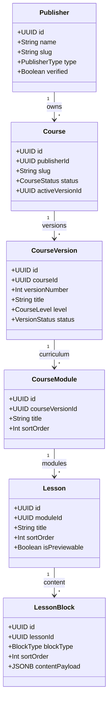

# CourseCity 1.0 — Marketplace & Multi-Publisher Architecture

## 1. The Publisher Abstraction

In CourseCity, courses are owned by **Publishers**, never directly by a solitary `user_id`. This architectural decision guarantees that individual instructors, educational institutions, enterprise training centers, and CourseCity itself share a unified data and permission model.



### 1.1 Publisher Types

1. **`PLATFORM`**: CourseCity official foundational courses created and maintained by the platform.
2. **`INSTRUCTOR`**: An individual verified educator or subject matter expert publishing independently.
3. **`ORGANIZATION`**: A school, university, technical academy, or corporate training organization publishing courses collaboratively.

---

## 2. Organization Structure & Scoped Access Control

An organization publisher manages multiple team members with distinct operational responsibilities:

| Organization Role      | Course Authoring     | Publishing Approval   | Financial / Order Access | Member Management |
| :--------------------- | :------------------- | :-------------------- | :----------------------- | :---------------- |
| **`OWNER`**            | Full CRUD            | Yes                   | Full Access              | Full Access       |
| **`ADMIN`**            | Full CRUD            | Yes                   | Read-only                | Manage non-owners |
| **`INSTRUCTOR`**       | Assigned Courses     | No (Submit to review) | None                     | None              |
| **`CONTENT_EDITOR`**   | Lesson Block Editing | No                    | None                     | None              |
| **`FINANCE_MEMBER`**   | None                 | None                  | Full Revenue / Orders    | None              |
| **`ANALYTICS_MEMBER`** | None                 | None                  | Read-only Metrics        | None              |

### Cross-Organization Isolation Invariant

Authorization checks always evaluate:
`(actor.id, publisher.id, requested_action)`
An instructor or admin in **Organization Alpha** has zero visibility or mutating capabilities inside **Organization Beta**, regardless of identical role names.

---

## 3. Course Versioning & Curriculum Immutability

### 3.1 Course Publishing Lifecycle

```text
DRAFT
  └──> IN_REVIEW
         └──> APPROVED
                └──> PUBLISHED
                       ├──> UNPUBLISHED (Temporarily delisted from catalog)
                       ├──> ARCHIVED (Historical record retained, no new sales)
                       └──> SUSPENDED (Platform administrative enforcement)
```

### 3.2 Immutability Invariant

- Once a `CourseVersion` transitions to `PUBLISHED` and learners enroll or purchase it, its curriculum structure (`course_modules`, `lessons`, `lesson_blocks`) becomes **strictly immutable**.
- This preserves the academic integrity of learner certificates, exam grades, and progress history.
- To introduce curriculum revisions, the publisher creates a new version (`versionNumber + 1`) in `DRAFT` status. Learners currently enrolled on version 1 remain pinned to version 1 unless an explicit course migration policy is triggered.

---

## 4. Atomic Content Block Architecture

CourseCity rejects the anti-pattern of storing an entire lesson or course as a single unstructured blob of raw HTML. Lessons are composed of ordered, atomic, typed **Content Blocks**:

### V1 Active Content Block Types

- **`HEADING`**: Semantic section breaks (`h1`, `h2`, `h3`).
- **`PARAGRAPH`**: Markdown-formatted typography with footnotes and links.
- **`IMAGE`**: Optimized responsive images with caption, alt text, and lightbox support.
- **`CODE`**: Multi-language code snippets with syntax highlighting, line numbers, and copy-to-clipboard.
- **`TABLE`**: Tabular comparison data with responsive mobile horizontal scrolling.
- **`CALLOUT`**: Highlight boxes (`info`, `warning`, `tip`, `danger`).
- **`QUOTE`**: Editorial blockquotes with attribution and citation.
- **`DIAGRAM`**: Mermaid.js architectural and sequence diagrams rendered client-side.
- **`FORMULA`**: KaTeX mathematical expressions and equations.
- **`RESOURCE`**: Downloadable attachments, templates, and supplemental reading links.
- **`EXERCISE`**: Practical inline reflection prompt or code challenge.

### Future Deferred Block Modalities (V2 Architecture-Ready)

- `VIDEO_BLOCK`: Cloudflare Stream / HLS video player with timestamp bookmarks.
- `AUDIO_BLOCK`: Podcast-style audio lectures with playback speed controls.
- `INTERACTIVE_BLOCK`: Embedded WebContainer / Pyodide browser-based code playground.
- `QUIZ_BLOCK`: Embedded formative checkpoint quiz.
- `ASSIGNMENT_BLOCK`: Inline submission portal.

---

## 5. Future Marketplace Settlement Roadmap (V2 Deferred)

The database schema and service interfaces are designed for future marketplace settlement without requiring core entity refactoring:

- **Seller Accounts**: KYC-verified banking and mobile money destination profiles.
- **Commission Rules**: Platform fee percentage schedules (e.g. 15% platform fee, 85% instructor payout).
- **Seller Balances**: Ledger-based escrow and pending balance tracking.
- **Payout Engine**: Automated monthly batch transfers via Paystack Transfers API.
