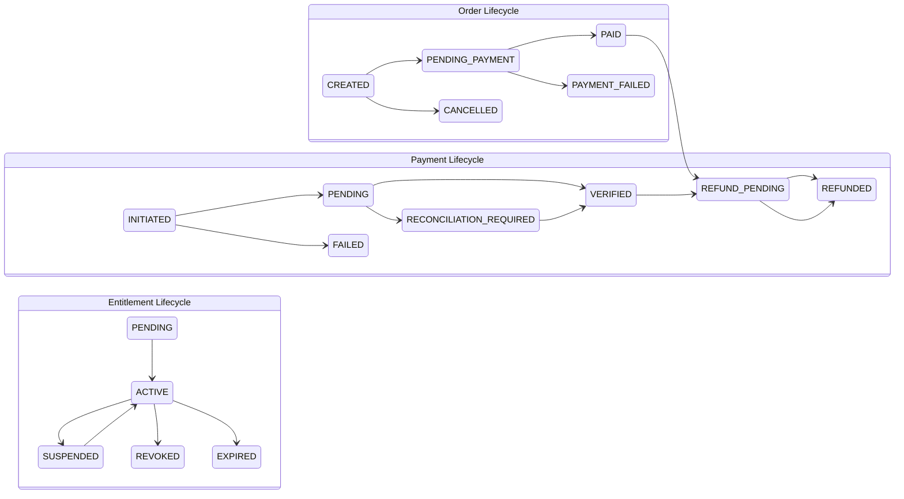
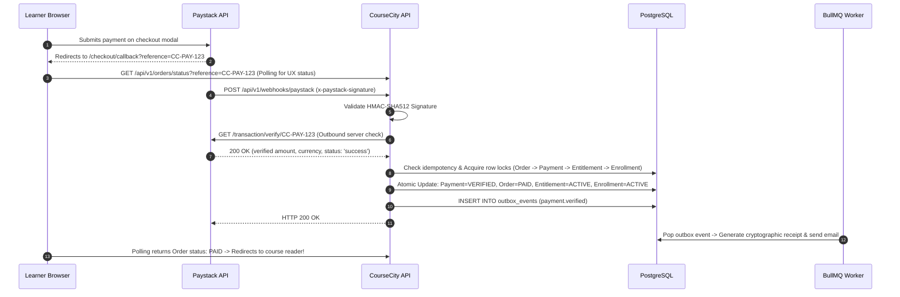

# CourseCity 1.0 — Payment Architecture & Reconciliation

## 1. Commercial Model & Financial Principles

CourseCity 1.0 operates on an upfront purchase and enrollment model:

- **Free Courses**: Direct entitlement activation through `POST /api/v1/enrollments/free`.
- **Paid Individual Courses**: Purchased via a single-item or cart order checkout process.
- **Minor Currency Units**: All monetary amounts are handled strictly as **64-bit integer minor units** (e.g. 15,000 pesewas = GHS 150.00; 2,500 cents = USD 25.00). Floating-point arithmetic is strictly prohibited in commerce code.

---

## 2. Decoupled Commercial State Machines

To prevent state conflation, the commercial model strictly decouples the Order, Payment, and Entitlement lifecycles into distinct state machines:



---

## 3. Provider Abstraction (`IPaymentProvider`)

All payment operations are isolated behind the `IPaymentProvider` interface to ensure zero vendor lock-in and enable seamless migration to future payment aggregators or Stripe:

```typescript
export interface InitializePaymentParams {
  orderReference: string;
  paymentReference: string;
  amountMinor: bigint;
  currency: string;
  customerEmail: string;
  customerName?: string;
  callbackUrl: string;
  metadata?: Record<string, unknown>;
}

export interface PaymentInitializationResult {
  providerReference: string;
  authorizationUrl: string;
  accessCode?: string;
}

export interface VerifyPaymentResult {
  isSuccessful: boolean;
  providerTransactionId: string;
  providerReference: string;
  amountMinor: bigint;
  currency: string;
  paidAt: Date;
  rawResponse: Record<string, unknown>;
}

export interface IPaymentProvider {
  readonly providerName: string;
  initializePayment(params: InitializePaymentParams): Promise<PaymentInitializationResult>;
  verifyPayment(providerReference: string): Promise<VerifyPaymentResult>;
  verifyWebhookSignature(rawBody: Buffer | string, signatureHeader: string): boolean;
  processRefund(
    paymentReference: string,
    amountMinor: bigint,
    reason: string,
  ): Promise<RefundResult>;
}
```

---

## 4. Payment Verification & Double-Verification Defense

Browser callbacks (`https://coursecity.com/checkout/callback?reference=...`) are treated as **purely UX signals**. Under no circumstances is course entitlement granted based on client redirects.

### Authoritative Double-Verification Sequence

1. **Inbound Webhook Receipt**:
   - Paystack sends `POST /api/v1/webhooks/paystack`.
   - The API verifies the `x-paystack-signature` header using `HMAC-SHA512` and the server's secret key.
   - If signature verification fails, the request is immediately rejected (`HTTP 400 Bad Request`) and logged as a security alert.
2. **Independent Outbound Verification**:
   - Before mutating internal state, the API executes an independent outbound HTTP request to the official Paystack verification endpoint (`GET https://api.paystack.co/transaction/verify/:reference`).
3. **Payload Invariant Validation**:
   - The verified provider amount must exactly match the stored order `total_amount_minor`.
   - The verified provider currency must match the stored order `currency`.
   - The transaction status must be `success`.
   - The provider reference must map to an existing payment in state `INITIATED` or `PENDING`.



---

## 5. Concurrency, Race Condition & Idempotency Rules

### 5.1 Idempotency Key Handling

- Every checkout initiation requires a client-supplied idempotency key (header `Idempotency-Key: uuid`).
- The API records the key in `idempotency_keys` with a **72-hour TTL**.
- If a duplicate payment webhook or retry occurs:
  - If the payment is already in state `VERIFIED`, the system acknowledges the webhook (`HTTP 200 OK`) and returns the previously committed result without duplicate processing.
  - If concurrent requests attempt to finalize the same transaction, PostgreSQL row locks force sequential processing; the second worker detects the `PAID` state and terminates safely.

### 5.2 Deterministic Row Locking (Deadlock Prevention)

When finalizing an order across multiple tables, the lock acquisition order is strictly enforced:

1. `SELECT * FROM orders WHERE id = $1 FOR UPDATE;`
2. `SELECT * FROM payments WHERE order_id = $1 FOR UPDATE;`
3. `SELECT * FROM entitlements WHERE order_id = $1 FOR UPDATE;`
4. `SELECT * FROM enrollments WHERE id = $1 FOR UPDATE;`

### 5.3 Network Isolation from Database Transactions

Network requests to Paystack (`verifyPayment`) are performed **outside** the database transaction. Once verification data is in memory, the database transaction executes in under 15ms.

---

## 6. Financial Reconciliation & Refunds

- **Automated Daily Reconciliation**: A BullMQ cron job fetches unsettled transactions from Paystack and matches them against `payments` and `orders`. Any discrepancies (amount mismatches, missing webhooks) are flagged as `RECONCILIATION_REQUIRED` in `payment_reconciliations`.
- **Refund Workflow**:
  - Refunds are restricted to users with the `refunds:create` permission (Finance Admin / Super Admin).
  - Every refund requires an explicit operator reason and records a permanent `refund_events` audit row.
  - Upon successful refund processing via `IPaymentProvider`, the order status transitions to `REFUNDED`, the entitlement is set to `REVOKED`, and the course enrollment is set to `CANCELLED`.
