# CourseCity 1.0 — Receipt & Verification Architecture

## 1. Cryptographic Verifiability Principle

CourseCity receipts are designed to be **mathematically tamper-evident digital instruments**.

> A visually indistinguishable counterfeit PDF designed with identical CourseCity typography, logos, watermarks, and layouts is completely fraudulent and **will immediately fail verification** when evaluated against the cryptographic verification engine. Visual security features (watermarks, microtext, QR codes) are purely supplementary convenience mechanisms; cryptographic digital signatures are the sole authoritative proof of authenticity.

---

## 2. Canonical Receipt Payload & Data Specification

To guarantee that JSON serialization inconsistencies (whitespace, key ordering) never invalidate digital signatures, all receipt payloads undergo **RFC 8785 JSON Canonicalization Scheme (JCS)** prior to cryptographic hashing.

### Canonical Receipt Schema

```typescript
export interface CanonicalReceiptPayload {
  receiptVersion: '1.0';
  receiptReference: string; // e.g. "CC-RCP-20261003-4M8P1K"
  orderReference: string; // e.g. "CC-ORD-20261003-8K9F2M"
  paymentReference: string; // e.g. "CC-PAY-20261003-7J2L9Q"
  providerTransactionId: string; // e.g. "pstk_tx_123456789"
  issuedAt: string; // ISO 8601 UTC: "2026-10-03T13:22:19.000Z"
  currency: string; // "GHS" | "USD"
  amountMinor: number; // 15000 (GHS 150.00)
  customer: {
    userId: string; // UUIDv7
    emailHashed: string; // SHA-256 hash of normalized email
    displayName: string;
  };
  publisher: {
    publisherId: string;
    publisherName: string;
  };
  items: Array<{
    itemReference: string;
    title: string;
    quantity: number;
    amountMinor: number;
  }>;
  signingKeyId: string; // Key identifier, e.g. "cc_ed25519_2026_v1"
}
```

---

## 3. Cryptographic Signing & Verification Pipeline

```mermaid
flowchart TD
    subgraph Generation ["Receipt Generation (Worker)"]
        INPUT["Verified Order & Payment Data"]
        CANON["RFC 8785 Canonical JSON Serialization"]
        HASH["SHA-256 Fingerprint Hash"]
        SIGN["Ed25519 Asymmetric Digital Signature"]
        RECORD[("Store in DB: canonical_payload, payload_hash, ed25519_signature")]
    end

    subgraph Verification ["Public Verification (/r/:receiptId)"]
        QUERY["Client requests verification of CC-RCP-..."]
        FETCH["Fetch receipt record from PostgreSQL"]
        CHECK_HASH["Recompute SHA-256 of Canonical Payload"]
        CHECK_SIG["Verify Ed25519 Signature against Public Key"]
        CHECK_STATE["Check revocation state and payment status"]
        RESULT["Return: VERIFIED | TAMPERED | REVOKED | NOT_FOUND"]
    end

    INPUT --> CANON --> HASH --> SIGN --> RECORD
    QUERY --> FETCH --> CHECK_HASH --> CHECK_SIG --> CHECK_STATE --> RESULT
```



### 3.1 Digital Signature Algorithm

- **Algorithm**: **Ed25519** (Edwards-curve Digital Signature Algorithm over Curve25519).
- **Payload Fingerprint**: Computed as `SHA-256(canonical_payload_string)`.
- **Signature**: Computed by signing the `payload_hash` using the platform's private Ed25519 key.
- **Storage**: The resulting 64-byte signature is encoded as Base64url and persisted in the `receipts` table.

### 3.2 Key Management & KMS Migration Path

- In the initial KVM 2 environment, the private key is passed via encrypted environment secrets (`RECEIPT_SIGNING_PRIVATE_KEY_ED25519`).
- Public keys are versioned in `receipt_signing_keys` with active date ranges.
- The system is engineered to seamlessly migrate to AWS KMS / Cloudflare Key Management Service or an HSM without requiring database migrations.

---

## 4. Public Verification Surface & Privacy Controls

### 4.1 Verification Endpoints

- **Web Interface**: `https://verify.coursecity.com/r/:receiptReference`
- **REST API**: `GET /api/v1/receipts/verify/:receiptReference`

### 4.2 Verification Check Pipeline

When a receipt is evaluated, the server conducts six consecutive verification assertions:

1. **Record Existence**: The receipt reference must exist in `receipts`.
2. **Payment Linkage**: The associated payment record must exist and have status `VERIFIED`.
3. **Order Integrity**: Order items, amounts, and currency must match the canonical receipt data.
4. **Fingerprint Invariant**: Re-hashing the stored canonical payload with SHA-256 must exactly equal the stored `payload_hash_sha256`.
5. **Cryptographic Validation**: The Ed25519 signature must mathematically validate against the active public key identified by `signing_key_id`.
6. **Revocation Check**: The receipt must not have been invalidated (`status != 'REVOKED'`).

### 4.3 Possible Outcomes

- **`VERIFIED`**: Receipt is fully authentic, signed by CourseCity, and untampered.
- **`NOT_FOUND`**: No receipt with this reference was ever issued.
- **`INVALID` / `TAMPERED`**: The cryptographic signature does not match the payload or public key.
- **`REVOKED`**: The transaction was refunded or voided by platform administrators.

### 4.4 Privacy & PII Protection

To protect learner privacy on public verification lookups, the public UI displays:

- Course and publisher names.
- Date and time of issuance.
- Verification status (`VERIFIED`).
- Cryptographic signature fingerprint (truncated).
- **Masked Customer Identity**: The learner's email and full name are masked (e.g. `J*** D**` / `j***@example.com`).

---

## 5. Visual Supplementary Anti-Counterfeit Elements

On the generated PDF and digital web receipt views, CourseCity incorporates supplementary visual security elements:

1. **Dynamic High-Density QR Code**: Directly links to the canonical verification URL (`https://verify.coursecity.com/r/CC-RCP-...`).
2. **Guilloche Security Watermark**: High-resolution mathematical geometric pattern rendered behind the receipt header.
3. **Microtext Border**: Repeating high-density text (`COURSECITY OFFICIAL VERIFIABLE RECORD`) embedded in divider rules.
4. **Visible Cryptographic Fingerprint**: The first 16 characters of the SHA-256 payload hash printed alongside the signature indicator.

These visual elements deter casual reproduction but are always explicitly labeled: _"Authenticate online at verify.coursecity.com"_.
