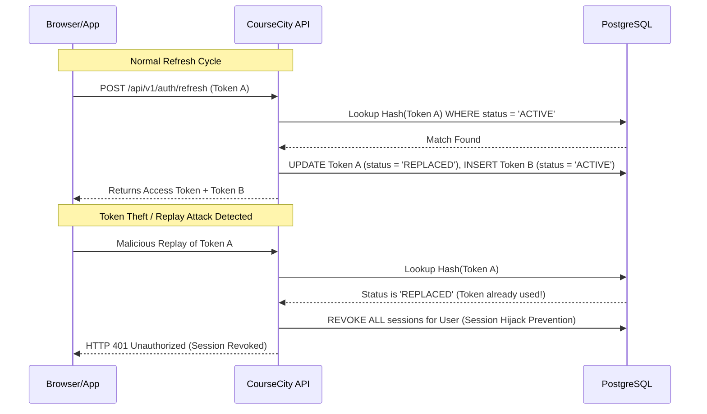

# CourseCity 1.0 — Security Architecture & Threat Model

## 1. Threat Model & Security Principles

Security is an uncompromised foundational requirement of CourseCity 1.0. All external requests are treated as untrusted. No security invariant is delegated to client-side code.

### Core Threat Mitigations

1. **Authentication Bypasses & Token Theft**: Mitigated by Argon2id password hashing, rotating refresh tokens with reuse detection, and device-bound session tracking.
2. **Broken Object Level Authorization (BOLA/IDOR)**: Mitigated by UUIDv7 identifiers and mandatory publisher-scoped database filters on all data mutations.
3. **Financial State Tampering**: Mitigated by cryptographic signature verification on webhooks, independent provider polling, and integer minor-unit arithmetic.
4. **Credential Forgery (Fake Receipts/Certificates)**: Mitigated by asymmetric Ed25519 digital signatures and server-side public verification endpoints.
5. **Race Conditions & Concurrency Exploits**: Mitigated by PostgreSQL transaction isolation, deterministic row-locking orders, and strict idempotency keys.

---

## 2. Authentication & Session Architecture

### 2.1 Password Hashing (Argon2id)

All user passwords are encrypted using state-of-the-art **Argon2id** with strict parameters:

- Memory: 64 MB (65,536 KiB)
- Iterations: 3 passes
- Parallelism: 4 threads
- Output hash length: 32 bytes

Plaintext passwords are never logged, cached, or persisted.

### 2.2 Short-Lived Access Tokens & Rotating Refresh Tokens

- **Access Tokens**: Short-lived (15 minutes lifetime), containing the user ID, active role, and publisher memberships.
- **Refresh Tokens**: Rotating cryptographically random tokens (32 bytes entropy, Crockford Base32 encoded).
  - Stored in the database only as a **SHA-256 hash**.
  - **Rotation on Refresh**: Every call to `POST /api/v1/auth/refresh` invalidates the presented refresh token and issues a new token pair.
  - **Reuse Detection**: If a previously consumed or revoked refresh token is presented, the system flags a token theft attempt, immediately revokes the **entire session family**, and logs a high-priority `SECURITY_ALERT` audit record.



### 2.3 Secure Web Cookies & CSRF Defense

- Web clients store session/refresh tokens in **`HttpOnly`**, **`Secure`**, **`SameSite=Lax`** cookies.
- Mutating endpoints (`POST`, `PUT`, `DELETE`, `PATCH`) enforce CSRF validation via strict `Origin` header checking matching the allowed domain list and custom `X-Requested-With` header verification.

### 2.4 Multi-Factor Authentication (MFA)

- Required for all privileged roles (`ADMIN`, `FINANCE_ADMIN`, `SUPER_ADMIN`).
- Implemented via RFC 6238 TOTP (Time-Based One-Time Passwords).
- TOTP shared secrets are encrypted at rest using AES-256-GCM before database insertion.
- Step-up authentication (re-verifying TOTP code or password) is required for sensitive administrative operations (role mutation, refunds, receipt revocation, API key issuance).

---

## 3. Authorization & Scoping Model (RBAC + Resource Scoping)

CourseCity combines **Role-Based Access Control (RBAC)** with **Fine-Grained Permissions** and **Resource Scoping**.

### 3.1 Permission Format

Permissions are represented as canonical action strings:

- `courses:read`, `courses:create`, `courses:update`, `courses:publish`, `courses:delete`
- `users:read`, `users:manage`, `users:suspend`
- `finance:read`, `payments:read`, `refunds:create`
- `receipts:verify`, `receipts:revoke`
- `api:keys:manage`, `system:settings:manage`

### 3.2 Publisher Scoping Rule

A user assigned the role `INSTRUCTOR` or `CONTENT_EDITOR` within Organization A has zero access to Organization B, even though their role names are identical:

```typescript
// Authorization Interceptor:
export async function assertCanMutateCourse(actor: AuthUser, courseId: string) {
  const course = await getCourseById(courseId);
  if (!course) throw new ResourceNotFoundError();

  // SuperAdmin has global scope
  if (actor.roles.includes('SUPER_ADMIN')) return true;

  // Check user membership within the course's publisher
  const membership = await getPublisherMembership(actor.id, course.publisherId);
  if (!membership || !hasPermission(membership.role, 'courses:update')) {
    throw new ForbiddenError('You lack permission to mutate courses for this publisher.');
  }
}
```

---

## 4. Input Validation, Sanitization & Network Hardening

### 4.1 Multi-Layered Validation

1. **Transport Layer**: Fastify Zod schema validation strips unknown fields and validates types, string lengths, and numeric bounds.
2. **Domain Layer**: Business invariants and permitted state machine transitions are enforced.
3. **Database Layer**: NOT NULL, CHECK, UNIQUE, and FOREIGN KEY constraints provide durable data integrity.

### 4.2 File Upload Defense

All file uploads (e.g., student assignment submissions, course cover art) undergo:

1. File size enforcement (max 10MB for documents, 5MB for images).
2. Magic number / file signature inspection (verifying actual file bytes against stated MIME type).
3. Stripping of original client filenames; files are stored using immutable UUID keys in object storage.
4. Downloads are served with `Content-Disposition: attachment` or via short-lived signed URLs.

### 4.3 HTTP Security Headers (Caddy & Fastify)

- `Strict-Transport-Security: max-age=63072000; includeSubDomains; preload`
- `X-Content-Type-Options: nosniff`
- `X-Frame-Options: DENY`
- `Referrer-Policy: strict-origin-when-cross-origin`
- `Content-Security-Policy`: Restricts scripts to trusted origins and eliminates unsafe eval/inline scripts.

---

## 5. High-Risk Security Invariants (Non-Negotiable)

1. A frontend client can **never** mark a payment successful or verified.
2. A frontend client can **never** grant an entitlement or create a course enrollment.
3. A frontend client can **never** mark a certificate as issued.
4. A frontend client can **never** modify user roles or permissions.
5. An instructor or organization administrator can **never** cross publisher boundaries.
6. A receipt or certificate is considered authentic **only** if its cryptographic Ed25519 signature passes server-side mathematical verification.
7. Webhook payloads are **only** processed after verifying provider HMAC-SHA512 signatures.
8. API keys and refresh tokens are **never** stored in plaintext.
9. Database connections and Redis instances are **strictly bound to private networks** with zero direct public internet exposure.
