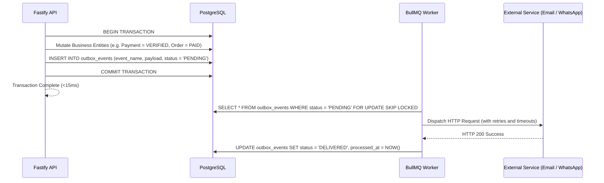

# CourseCity 1.0 — System Architecture Overview

## 1. High-Level Architectural Topology

CourseCity is built as an **API-first, distributed monolithic core** organized in a strict monorepo structure. All front-facing clients (Web, future Mobile, third-party consumers) are treated as untrusted consumers communicating through versioned HTTPS APIs.

```mermaid
flowchart TD
    subgraph Edge ["Public Edge & CDN (Cloudflare)"]
        CF_DNS["Cloudflare DNS & DDoS Shield"]
        CF_WAF["Cloudflare WAF & Edge Cache"]
        CF_SSL["Cloudflare Universal SSL"]
    end

    subgraph Hostinger ["Hostinger KVM 2 VPS (Docker Network)"]
        CADDY["Caddy Reverse Proxy & TLS Terminator"]

        subgraph Frontends ["Presentation Layer"]
            WEB["Next.js Web Client (SSR/SSG/ISR) :3000"]
        end

        subgraph CoreServices ["Application Layer (Fastify Core)"]
            API["Fastify API Service :4000 (OpenAPI 3.1)"]
            WORKER["BullMQ Async Background Worker"]
        end

        subgraph PrivateDataLayer ["Isolated Private Data Network"]
            PG[("PostgreSQL 16 (Durable Source of Truth)")]
            REDIS[("Redis 7 (Ephemeral Cache, Queues & Locks)")]
        end
    end

    subgraph ExternalProviders ["Authoritative External Services"]
        PAYSTACK["Paystack Payment Gateway"]
        EMAIL_SVC["Transactional Email Provider"]
        WHATSAPP_SVC["WhatsApp Business API"]
        R2_STORAGE["Cloudflare R2 Object Storage"]
    end

    CF_DNS --> CF_WAF --> CF_SSL --> CADDY
    CADDY -->|coursecity.com| WEB
    CADDY -->|api.coursecity.com| API
    CADDY -->|verify.coursecity.com| WEB

    WEB -->|REST / JSON (X-API-Key or Bearer/Cookies)| API
    API -->|Typed SQL via Kysely| PG
    API -->|Cache / Rate Limits / Queue Dispatch| REDIS
    API -->|Init Payment / Verify Tx| PAYSTACK
    API -->|Signed Asset URLs| R2_STORAGE

    REDIS -->|Job Processing / Outbox Consumption| WORKER
    WORKER -->|Transactional State Checks| PG
    WORKER -->|Send Receipts / Alerts| EMAIL_SVC
    WORKER -->|Operational Notifications| WHATSAPP_SVC
```

---

## 2. Monorepo Structure & Package Hierarchy

The repository uses **pnpm workspaces** and **Turborepo** to enforce clean architectural boundaries and prevent circular dependencies.

```text
coursecity/
├── apps/
│   ├── web/                    # Next.js 15+ App Router web client (Learner & Verification UI)
│   ├── api/                    # Fastify API Server (Authoritative business core & OpenAPI spec)
│   └── mobile/                 # Future client (React Native + Expo Router)
│
├── packages/
│   ├── contracts/              # Shared TypeScript interfaces, DTOs, and API error contracts
│   ├── validation/             # Zod validation schemas (shared across frontend & backend)
│   ├── api-client/             # Strongly typed API client library for Web and Mobile
│   ├── database/               # Kysely DB connection, types, schema definitions & migrations
│   ├── auth/                   # Shared authentication tokens, permission constants & helpers
│   ├── design-tokens/          # CourseCity design tokens (Colors, Typography, Radii, Shadows)
│   ├── design-system/          # Accessible UI component library (Tailwind, Radix, Lucide)
│   └── shared/                 # Universal utilities (crypto, formatting, datetime, minor units)
│
├── infrastructure/
│   ├── docker/                 # Production & Development multi-stage Dockerfiles & compose
│   ├── caddy/                  # Caddyfile configuration with reverse proxy & security headers
│   ├── postgres/               # PostgreSQL initialization scripts & configuration
│   └── redis/                  # Redis persistence & security configuration
│
├── docs/                       # Authoritative engineering, product, and architecture docs
├── scripts/                    # Database seeding, migration tooling, and deployment automation
├── .github/workflows/          # Continuous Integration & Delivery pipelines
├── package.json
├── pnpm-workspace.yaml
├── turbo.json
└── README.md
```

### Dependency Flow Rules

1. `apps/*` may depend on `packages/*`.
2. `packages/contracts` and `packages/shared` have zero internal package dependencies.
3. `packages/validation` depends only on `packages/contracts`.
4. `packages/api-client` depends on `packages/contracts` and `packages/validation`.
5. Under no circumstances may backend server code (`apps/api` or `packages/database`) be imported into frontend web or mobile apps.

---

## 3. Network Trust Boundaries & Security Zones

| Zone                          | Exposure                 | Components                                | Permitted Inbound Traffic                                               |
| :---------------------------- | :----------------------- | :---------------------------------------- | :---------------------------------------------------------------------- |
| **Zone 0: Public Internet**   | Untrusted                | Browsers, Mobile Devices, Webhook Callers | HTTPS (443) via Cloudflare to Caddy                                     |
| **Zone 1: DMZ / Web Proxy**   | Public Entry             | Caddy Reverse Proxy                       | Port 80 (HTTP->HTTPS redirect), Port 443                                |
| **Zone 2: Presentation Tier** | Container Internal       | Next.js Node server                       | Only reverse-proxied traffic from Caddy (`localhost:3000`)              |
| **Zone 3: API Service Tier**  | Container Internal       | Fastify API server (`localhost:4000`)     | Reverse-proxied traffic from Caddy; internal Next.js SSR requests       |
| **Zone 4: Async Processing**  | Container Internal       | BullMQ Worker                             | Listens to Redis Queue events. Zero public HTTP ingress                 |
| **Zone 5: Data Storage Tier** | Isolated Private Network | PostgreSQL 16, Redis 7                    | Local unix sockets / Docker bridge network only. Never exposed publicly |

---

## 4. Asynchronous Outbox Pattern & Worker Topology

To guarantee absolute transactional consistency without holding database transactions open during external network requests (Paystack, Email, WhatsApp, Object Storage), CourseCity employs the **Transactional Outbox Pattern**:



### Dead-Letter & Replay Policy

- If an outbox event fails delivery, the worker retries with exponential backoff and jitter up to 5 attempts.
- Events that exhaust retry attempts transition to `DEAD_LETTER` state in `dead_letter_events`.
- Dead-letter records retain full request payloads and failure traces, inspectable and replayable via the SuperAdmin console.

---

## 5. Observability, Telemetry & Health Checks

### Health Endpoints

- **`GET /healthz` (Liveness)**:
  - Validates process liveness. Returns `HTTP 200 OK` with uptime and process memory statistics.
- **`GET /readyz` (Readiness)**:
  - Performs active connection probes to PostgreSQL (`SELECT 1`) and Redis (`PING`).
  - Returns `HTTP 200 OK` if all core dependencies are healthy; returns `HTTP 503 Service Unavailable` with degraded component metadata if any probe fails.

### Structured Logging (Pino)

Every request generates a structured JSON log containing:

```json
{
  "level": 30,
  "time": 1790947200000,
  "pid": 1042,
  "hostname": "cc-api-01",
  "requestId": "req_01j7abc123456789",
  "actorId": "usr_01j7xyz987654321",
  "route": "/api/v1/orders",
  "method": "POST",
  "statusCode": 201,
  "durationMs": 42.1,
  "service": "coursecity-api",
  "environment": "production"
}
```

**Strict Redaction Policy**: Passwords, refresh tokens, Bearer tokens, Paystack secret keys, raw card data, and Ed25519 private keys are programmatically redacted at the logger transport level.

---

## 6. Disaster Recovery & Backup Strategy

1. **Database Backups**:
   - Automated daily logical backups (`pg_dump` with custom compressed format) executed via cron.
   - Immediate client-side AES-256-GCM encryption before offsite transfer.
   - Encrypted backups uploaded directly to offsite S3-compatible cold storage (Cloudflare R2 / AWS S3 backup bucket).
   - 30-day retention window with automated pruning.
2. **Restoration Runbook**:
   - Documented step-by-step restoration pipeline in `docs/runbooks/database-restore.md`.
   - Monthly automated restore verification test in an isolated test environment.
3. **Stateless App Nodes**:
   - The Next.js and Fastify containers maintain zero durable state on disk. All user assets are stored in S3/R2 with signed URLs. Application code and configuration are 100% reproducible via Git and Docker Compose.
