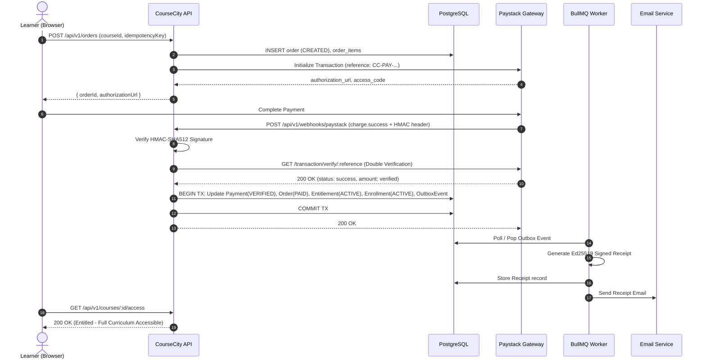
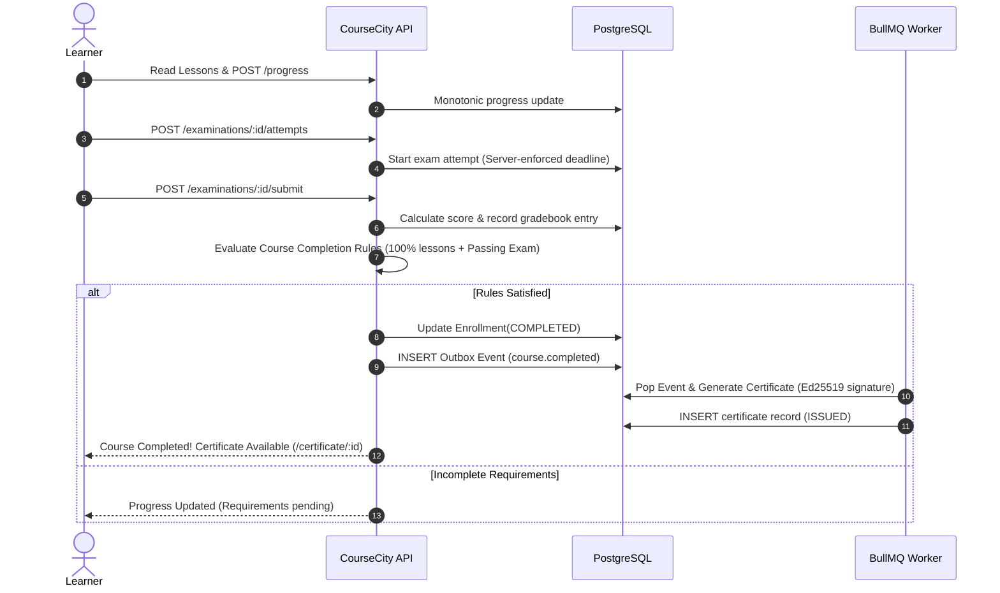

# CourseCity 1.0 — Product Requirements & Scope Document

## 1. Executive Summary & Mission

**CourseCity 1.0** is an enterprise-grade, API-first learning platform and future multi-publisher course marketplace.

The initial product release (V1) is engineered around a comprehensive, distraction-free learner experience focused on ebook- and tutorial-based courses. The architectural foundation is designed from day one to accommodate future multi-media modalities (video, audio, interactive code runtimes) and a decentralized marketplace without requiring structural refactoring of the core domain, authentication, authorization, or commerce layers.

### Core Architectural Principle

> The web application, future mobile application (React Native + Expo), and any third-party integrations are strictly clients of CourseCity. The CourseCity API and domain services are solely authoritative for authentication, authorization, payments, entitlements, learning access, grading, receipts, certificates, and marketplace data. Client applications never dictate entitlement, enrollment status, or administrative privilege.

---

## 2. Product Scope Matrix: V1 vs. V2 vs. Future Deferred

| Feature Domain          | V1 Active Scope (Frozen)                                                                     | V2 Planned Evolution                                            | Future Marketplace & Enterprise                                                                    |
| :---------------------- | :------------------------------------------------------------------------------------------- | :-------------------------------------------------------------- | :------------------------------------------------------------------------------------------------- |
| **Course Modality**     | Structured Ebook / Tutorial (Rich Markdown/Block Content, Code, Diagrams, Tables, Exercises) | Embedded Video Lessons, Audio Lessons                           | Interactive Code Sandboxes, Live Streaming Classes, Collaborative Whiteboards                      |
| **Commercial Model**    | Free Course Enrollment, Paid Individual Course Purchase (Direct Order)                       | Promotional Bundles, Discount Vouchers, Multi-currency Checkout | Premium & Pro Recurring Subscriptions, Team/Enterprise Licensing, Gift Courses                     |
| **Payment Provider**    | Paystack (Verified Webhook + Independent Server Verification)                                | Mobile Money Aggregators, Stripe (Global)                       | Direct Bank Transfer Reconciliation, Multi-provider Fallback                                       |
| **Publisher Model**     | Single Platform & Approved Instructor Publishing with Organization Membership scoping        | Multi-publisher Self-onboarding, Publisher Verification Tiers   | Marketplace Settlements, Split Payments, Commission Schedules, Seller Payouts & Tax Withholding    |
| **Learner Features**    | Catalog search/filter, Course reader, Progress tracking, Notes, Bookmarks, Learning History  | Social highlights, Study groups, Exportable learning records    | AI Personal Tutor, Gamification (streaks, badges, XP), Discussion Forums, Course Reviews & Ratings |
| **Assessments**         | Quizzes (Auto-graded), Assignments (Manual submission & grading), Timed Exams, Gradebook     | Peer-reviewed assignments, Question randomization pools         | Proctored remote examinations, Plagiarism detection pipelines                                      |
| **Credentials & Proof** | Cryptographic Ed25519 Receipts (Public verification), Verifiable Course Certificates         | Linked Open Badges, LinkedIn Certificate Integration            | On-chain credential notarization / verifiable credentials (W3C VC)                                 |
| **Client Platforms**    | Mobile-first Responsive Web App (Next.js, Radix, Tailwind CSS)                               | Official Mobile App (React Native + Expo, Expo Router)          | Offline mobile course synchronization, Native Desktop Reader                                       |
| **Developer Platform**  | OpenAPI 3.1 Spec, Scoped API Keys, Rate Limiting, Signed Outbound Webhooks                   | Developer Sandbox environment, Self-serve API key portal        | OAuth 2.1 + PKCE Authorization Server, GraphQL API surface                                         |

---

## 3. V1 User Personas & Capability Specifications

### 3.1 Learner (Primary Consumer)

A registered learner is granted a complete first-generation learning experience without artificial paywalls or synthetic Pro limits.

- **Identity & Account**:
  - Secure registration with email and password (Argon2id hashing).
  - Mandatory email verification via high-entropy, short-lived, single-use hashed tokens.
  - Session lifecycle management (view active sessions by user-agent/IP, revoke remote sessions).
  - Self-service password reset and profile management.
- **Course Discovery**:
  - Public course catalogue with full-text search (PostgreSQL trigram/FTS).
  - Filtering by category, difficulty level, and sorting by recency/popularity.
  - Course detail view with curriculum preview, syllabus outline, and instructor bio.
- **Commerce & Access**:
  - Instant enrollment in free courses.
  - Checkout and purchase of paid courses via Paystack with minor-currency accuracy.
  - Receipt generation upon verified payment; delivery via transactional email and in-app notification.
  - Immediate course access granted solely after server-side entitlement activation.
- **Learning Experience (Ebook / Tutorial)**:
  - Distraction-free, mobile-first reader interface.
  - Structured modular navigation: Course -> Modules -> Lessons -> Blocks.
  - Rich content block rendering: Headings, text, images, code blocks with syntax highlighting, tables, quotes, callouts, diagrams, formulas, resources.
  - Persistent, monotonic progress tracking (auto-marked on lesson completion, protected from concurrent regressions).
  - Personal annotations (learner notes) and lesson bookmarks.
  - Comprehensive learning activity timeline.
- **Assessments & Evaluation**:
  - Take modular quizzes with instant automated scoring.
  - Submit open-ended assignments (file attachment / text) for instructor grading.
  - Take timed, server-enforced examinations with countdown timers and automated timeout handling.
  - View detailed gradebook entries and performance feedback.
- **Credentials & Verification**:
  - Automatic evaluation of course completion rules upon final module/assessment completion.
  - Generation of cryptographically signed, tamper-evident Certificates.
  - Access to public verification surfaces for both Receipts (`/r/:receiptId`) and Certificates (`/certificate/:certificateId`).

### 3.2 Instructor (Content Creator within Publisher Scope)

- Creation and authoring of courses, curriculum modules, lessons, and content blocks.
- Management of question banks, quizzes, assignments, and examinations.
- Review of student assignment submissions and recording of manual grades with feedback.
- Scope isolation: An instructor can only read and mutate content explicitly linked to their assigned Publisher/Organization.

### 3.3 Publisher / Organization Administrator

- Management of Organization profile, instructor assignments, and publishing workflows.
- Course lifecycle management: `DRAFT` -> `IN_REVIEW` -> `APPROVED` -> `PUBLISHED`.
- Learner enrollment monitoring and publisher-level academic analytics.

### 3.4 Platform Administrator

- Operational supervision of users, courses, publishers, orders, and payment records.
- Facilitation of learner support requests and manual grade disputes.
- Initiation of order refunds under strict audit logging and financial approval gates.

### 3.5 Super Administrator (Platform Governance)

- Global authorization across all publishers, organizations, and platform settings.
- Staff management: assignment of platform roles and fine-grained permissions.
- System security governance: MFA enforcement, session invalidation, cryptographic key rotation.
- Management of platform feature flags, maintenance windows, and system status broadcasts.
- Inspection of security audit logs and outbox/dead-letter queues.

### 3.6 API Client / Third-Party Developer

- Programmatic consumption of public catalog and learner-authorized resources via scoped API keys (`X-API-Key`).
- Real-time event consumption via cryptographically signed HTTP webhooks with replay protection.

---

## 4. End-to-End Golden Path Workflows

### 4.1 Purchase & Entitlement Activation

### 4.2 Learning, Assessment & Certification Completion

---

## 5. Non-Functional & Operational Requirements

1. **Response Time & Performance**:
   - P95 API response time < 150ms for cached public catalogue queries.
   - P95 API response time < 250ms for authenticated learner transactions.
   - Initial page load LCP < 2.0s on 4G mobile networks.
2. **Availability & Resilience**:
   - 99.9% uptime target on single-node VPS architecture with proactive health checking (`/healthz`, `/readyz`).
   - Graceful degradation: in case of database or payment provider incidents, read-only cached content remains accessible with clear status indicators.
3. **Data Integrity & Traceability**:
   - Zero tolerance for orphaned financial states: payments, orders, entitlements, enrollments, and receipts must remain perfectly cross-referenced.
   - Complete audit logging of all sensitive role changes, refunds, and credential revocations.
